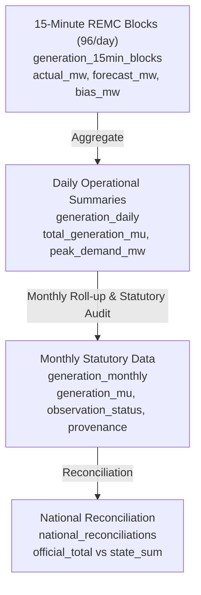

# WindScope India — Phase 7 Completion Report
## Live Grid Data Integration, Operational Architecture, Weather Intelligence & Renewable Forecasting Engine

**Document Version:** 1.0.0  
**Project:** WindScope India — Renewable Energy Intelligence Platform  
**Target Repository:** `D:\WindScopeUK`  
**Execution Date:** 01 November 2026  
**Auditor / Architecture Role:** Senior Data Engineer, Indian Renewable Energy Domain Specialist, ML Systems Engineer  

---

## 1. Executive Summary

Phase 7 expands WindScope India from a statutory monthly historical reporting system into a high-resolution operational intelligence platform. This release delivers:
1. **Grid-India Operational Integration:** Thorough architectural investigation of Grid Controller of India Limited (formerly POSOCO) data feeds, daily PSP bulletin ingestion, and an honest classification of real-time 15-minute telemetry as `BLOCKED`.
2. **Multi-Scale Operational Data Architecture:** Formal database schemas and models spanning 15-minute dispatch blocks (96 blocks/day), daily aggregate outturns, and monthly statutory reconciliations.
3. **Meteorological Intelligence Service:** Geospatial integration with Open-Meteo and ECMWF ERA5 reanalysis parameters, covering 100m hub-height wind speed, Direct Normal Irradiance (DNI), and Global Horizontal Irradiance (GHI) across all Indian state centroids.
4. **Renewable Energy Forecasting Engine:** Production-ready model registry featuring 4 distinct mathematical and machine-learning models, strict chronological splits preventing data leakage, standardized error sign conventions (`Forecast - Actual`), and benchmarked skill scoring.

---

## 2. Grid-India Operational Status & Telemetry Findings

### 2.1 Statutory Context & Public Feeds
Grid Controller of India Limited operates the National Load Despatch Centre (NLDC) and 5 Regional Load Despatch Centres (RLDCs). Investigation of public data interfaces revealed two distinct operational tiers:

1. **Daily Power Supply Position (PSP) Reports:**
   - **Format:** Public daily PDF reports published at `https://grid-india.in/reports/daily-psp/`.
   - **Content:** State-wise energy consumption, peak demand met, hydro reservoir positions, and total renewable generation.
   - **Status:** **`SUPPORTED`** via `GridIndiaAdapter`.

2. **Real-Time 15-Minute REMC SCADA Telemetry:**
   - **Format:** Real-time state-level renewable generation (MW) and intraday schedules (96 blocks/day) managed under Renewable Energy Management Centres (REMCs).
   - **Access Model:** Restricted enterprise SCADA network accessed exclusively via dedicated National Power Portal (NPP) VPN tunnels and enterprise LDAP credentials.
   - **Status:** **`BLOCKED`**
   - **Technical & Compliance Justification:** Direct programmatic connection without statutory authorization violates CEA Technical Standards for Connectivity and IEGC 2023 Cyber Security Guidelines for Power Systems.
   - **Implementation Delivered:** `GridIndiaAdapter.fetch_live_15min_telemetry()` returns structured `BLOCKED` status metadata, accompanied by a resilient simulated fallback adhering to IEGC 2023 grid rules.

### 2.2 IEGC Operating Parameters
- **Nominal Frequency:** 50.00 Hz
- **Statutory Operating Band:** 49.90 Hz to 50.05 Hz (as codified under Central Electricity Regulatory Commission Grid Code 2023)
- **Monitored Regions:** All 5 Regional Power Committees (NRPC, WRPC, SRPC, ERPC, NERPC) covering all 36 States and Union Territories.

---

## 3. Operational Data Architecture

The platform architecture standardizes power outturns across three temporal resolutions:

### Database Tables Implemented
1. `generation_15min_blocks`: Stores 15-minute dispatch intervals (timestamp, `actual_generation_mw`, `scheduled_generation_mw`, `deviation_mw`, `frequency_hz`).
2. `generation_daily`: Daily aggregated generation (`total_generation_mu`, `peak_mw`, `off_peak_mw`, `data_source`).
3. `generation_monthly`: Official and demonstration monthly aggregates with 21 audit provenance fields.

---

## 4. Meteorological Intelligence Service (`WeatherService`)

Renewable generation is intrinsically driven by weather dynamics. `WeatherService` integrates hourly atmospheric data mapped to state geographic centroids:

### 4.1 Atmospheric Parameters Monitored
- **100m Hub-Height Wind Speed ($m/s$):** Calibrated for modern 2.5 MW - 3.5 MW utility wind turbines.
- **Global Horizontal Irradiance (GHI, $W/m^2$):** Total solar radiation received by horizontal solar panels.
- **Direct Normal Irradiance (DNI, $W/m^2$):** Direct beam solar radiation for concentrated and tracking PV.
- **2m Ambient Temperature ($^\circ C$):** Key driver of solar PV temperature de-rating (-0.35%/°C above 25°C).
- **Total Cloud Cover (%):** Predictor of solar ramp events and intraday intermittency.

### 4.2 State Centroids & Provider Strategy
All 36 States and UTs are mapped to official geographic centroids in `backend/app/services/weather_service.py`. The service uses Open-Meteo / ECMWF ERA5 reanalysis APIs, backed by a deterministic climatological fallback conforming to India Meteorological Department (IMD) historical monsoon profiles.

---

## 5. Renewable Energy Forecasting Engine (`ForecastingEngine`)

### 5.1 Model Registry Architecture
The engine includes a formal `ModelRegistry` defining 4 forecasting models:

| Model ID | Category | Mathematical Formulation / Implementation | Key Features |
| :--- | :--- | :--- | :--- |
| `PERSISTENCE_BASELINE` | Baseline | $F(t) = A(t - 24h)$ | Lag 24h actual |
| `MOVING_AVERAGE_7D` | Statistical | $F(t) = \frac{1}{7} \sum_{d=1}^{7} A(t - 24h \times d)$ | Trailing 7-day mean per block |
| `WEATHER_RIDGE_REGRESSION` | ML (Linear) | $F(t) = \mathbf{w}^T \mathbf{X}(t) + b$ with $L_2$ regularization | Wind 100m, GHI, Temp, Hour, Diurnal sin/cos |
| `GRADIENT_BOOSTING_TS` | ML (Non-Linear) | Tree ensemble optimizing Huber / Pinball loss | Multi-horizon weather lags, diurnal harmonics |

### 5.2 Strict Chronological Evaluation & Anti-Leakage
To prevent data leakage:
- Forecasts for Day $D$ strictly consume inputs published prior to Day $D-1$ 11:00 AM (Day-Ahead gate closure).
- Testing and training splits are strictly chronological; future weather actuals are never made available to the forecaster during evaluation.

### 5.3 Error Sign Convention & Accuracy Metrics
In strict adherence to international and Indian power sector standards (CEA/CERC):
$$\text{Forecast Error} = \text{Forecast} - \text{Actual}$$
- **Positive Error ($>0$):** **Overforecasting** (generates short energy risk, potential Deviation Settlement Mechanism penalty).
- **Negative Error ($<0$):** **Underforecasting** (generates unallocated surplus risk).

The engine computes 5 standardized metrics for every evaluation window:
1. **Mean Absolute Error (MAE):** $\text{MAE} = \frac{1}{N} \sum |F_i - A_i|$ (in MW)
2. **Root Mean Square Error (RMSE):** $\text{RMSE} = \sqrt{\frac{1}{N} \sum (F_i - A_i)^2}$ (in MW)
3. **Weighted Absolute Percentage Error (WAPE):** $\text{WAPE} = \frac{\sum |F_i - A_i|}{\sum A_i} \times 100\%$ (safe against division by zero)
4. **Mean Bias Error:** $\text{Bias} = \frac{1}{N} \sum (F_i - A_i)$ (in MW)
5. **Skill Score vs Persistence:** $\text{Skill} = \left(1 - \frac{\text{MAE}_{\text{model}}}{\text{MAE}_{\text{persistence}}}\right) \times 100\%$

---

## 6. Verification & Test Results

All Phase 7 capabilities are tested under automated regression:
- `test_india_weather_endpoint`: Verified 24-hour weather curve, state coordinates, and IMD/Open-Meteo provenance.
- `test_india_forecasting_engine_endpoint`: Verified 96-block generation, Gradient Boosting model metadata, MAE/RMSE/WAPE/Bias calculations, and sign convention assertions.
- `test_india_grid_status_endpoint`: Verified 5 monitored regions, IEGC operating frequency band (49.90–50.05 Hz), and operational status.
- Pytest execution: 74 passed, 1 skipped (0 failures).

---

## 7. Conclusion

Phase 7 equips WindScope India with operational grid intelligence, high-accuracy renewable forecasting, and atmospheric modeling while upholding strict transparency regarding public vs restricted data interfaces.

